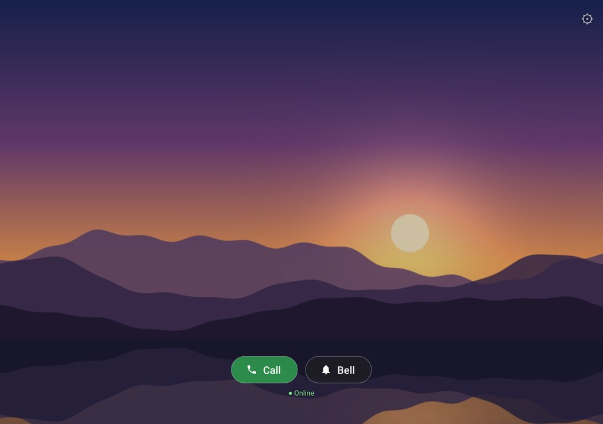
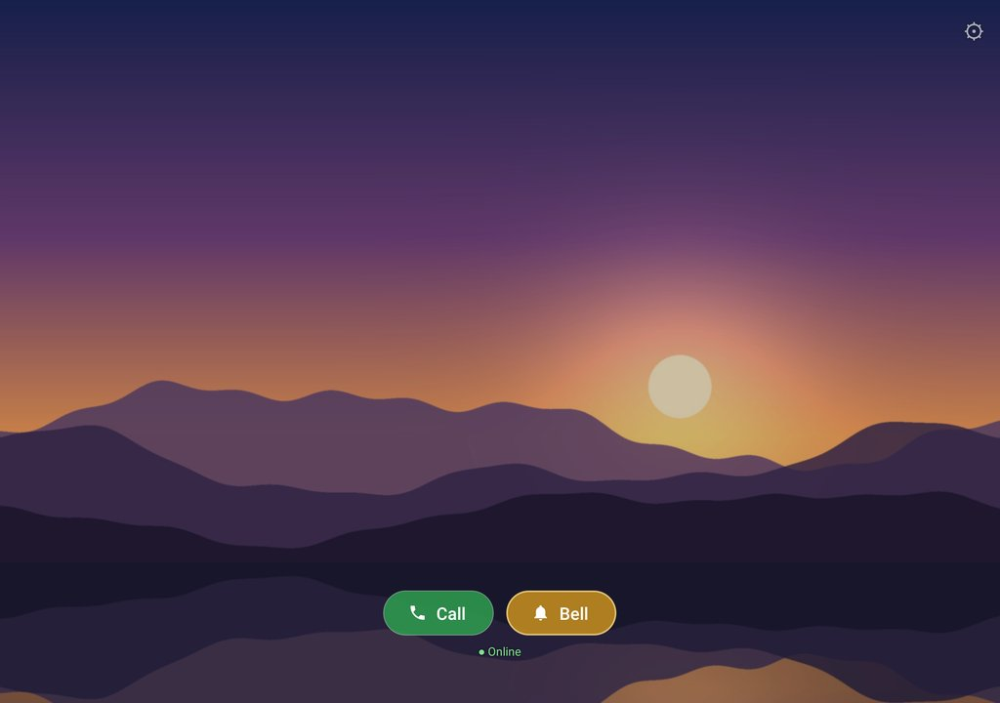

# Wall Intercom

Turn old Android tablets into wall-mounted **photo frames that double as a video intercom**
between rooms. No server, no cloud, no accounts: the tablets find each other on your home Wi-Fi
and talk directly to each other.

- Full-screen, cross-fading **slideshow** from a photo album on the tablet. To add photos,
  select them in Photos (or any app) → **Share → Wall Intercom**.
- Touch the screen and each tablet appears with an online dot and two buttons, **Call** and
  **Bell**. They stay for 25 s.
- **Pairing is one tap**: other tablets on the Wi-Fi show up by themselves, marked *new*.
  Pressing Call or Bell on a new tablet asks to pair; the other tablet shows the same 4-digit code
  and someone there presses **Accept**. Pairings survive IP and network changes.
- **Call** rings the other tablet: it wakes up and shows **Answer** / **Decline**. The camera
  and microphone stay off until someone there presses **Answer** (then a short chime plays
  so the room knows the camera is on). Unanswered calls stop after 45 s and show
  "Missed call from …". Either side can press **End call**.
- Optionally, a tablet can **answer automatically** (off by default, see settings): it rings
  the bell once, then the call starts by itself.
- **Bell** rings a ding-dong on the other tablet and shows "🔔 Bell from …" without turning on
  any camera, so the other room can call back when it suits them.
- If the Wi-Fi hiccups during a call it shows **Reconnecting…** and recovers by itself
  (for up to 30 s) instead of hanging up.
- Calls hang up automatically after 15 minutes (configurable), so a forgotten call doesn't
  leave a camera on all night.
- Dims at night, keeps itself running, and can start by itself after a reboot (optional), or
  act as the tablet's home screen on a tablet used only for this.
- English and Swedish, following each tablet's language setting.

Tested on two Lenovo Tab M10 (TB-X505F) running Android 10 and a Lenovo Tab 3 7" (TB3-710F)
running Android 5.0.1. Newer Android versions should work but haven't been tested yet; please
open an issue with how it goes on yours.

| Touch the photo: Call and Bell | Bell ringing on the other tablet | The other tablet got the bell |
|---|---|---|
|  |  |  |

*(Screenshots from the emulator with a generated test picture.)*

## Requirements

- Two Android tablets with **Android 5.0 or newer** and a front camera. Very old tablets may
  struggle with HD video; the default 640×480 is the safe choice.
- Both on the **same network**, and one that lets devices talk to each other (see
  [Troubleshooting](#troubleshooting)).

## Set up each tablet

1. Install the app: download `wall-intercom-<version>.apk` from the
   [latest release](https://github.com/yymer/wall-intercom/releases/latest) on the tablet and
   open it. Android asks you to allow installing from your browser, and may warn about an app
   from outside the Play Store or made for an older Android version. Open Wall Intercom and
   allow the camera, microphone and photos when it asks.

   Or from a computer with USB debugging on the tablet (`-g` grants the permissions up front):
   ```bash
   adb install -r -g wall-intercom-<version>.apk
   ```
2. Add photos: select them in Google Photos, Files or any other app → **Share** →
   **Wall Intercom**. They're copied into the album *Wall Intercom* (`Pictures/Wall Intercom`),
   which the slideshow shows by default. Sharing the same photo twice doesn't copy it again.
3. Open **Wall Intercom**. Tap the screen, then **press and hold ⚙** (top right) for settings:
   - *Name*: what the other tablets call this one, e.g. `Kitchen`.
   - Turn on *Start when the tablet is turned on*, so it can take calls again after a restart
     or power cut (off by default).
   - *See the pictures in the slideshow* shows what's in it. Optional: *Use a different album*
     shows another album on the tablet instead (e.g. Camera), or any folder, e.g. on an SD card.
   - Press *Allow waking up over other apps* and *Don't let Android put this app to sleep*
     (Android 6 and newer; Android 5 doesn't have these).
   - **Save**.
4. Optional, for a tablet that only runs Wall Intercom: turn on *Use as the tablet's home screen*
   in *Advanced settings*, then press the Home button and choose **Wall Intercom → Always**. The Home
   button and restarts then always come back to it. (Off by default, so it doesn't compete with
   the tablet's normal launcher.)
5. Android settings → *Security → Screen lock* → **None** (or *Swipe*), so calls aren't stuck
   behind the lock screen. With a PIN, pattern or password, Android keeps apps' data locked
   after a restart until someone unlocks the tablet, so Wall Intercom can't start by itself.
6. Pair the tablets: touch the photo, and press **Call** or **Bell** next to a tablet marked
   *new* (or press **Pair** under *Paired devices* in settings). Check that both tablets show the
   same code and press **Accept** on the other one. With more than two tablets, pair each two
   that should be able to call each other. (If a tablet never shows up, use *Advanced settings →
   Add device by IP address…*.)
7. If the tablet has **Dolby Atmos** or similar sound "enhancement", turn it off
   (Settings → Sound). It confuses echo cancellation and causes echo/noise during calls.

The port (default 47555) must be the same on all tablets.

## Keeping the tablets plugged in

Wall tablets are usually on a charger around the clock. Kept at 100% all the time, a lithium
battery wears out faster and can eventually swell, so if the tablet can **stop charging at a
lower level**, turn that on:

- Many tablets have this built in, under names like *Battery protection mode* (Lenovo, stops
  at 60%), *Protect battery* (Samsung, 85%), *Battery care* / *charging limit* (Sony, Asus) or
  *Charging optimization* (Google Pixel Tablet, 80%). Look in *Settings → Battery*; names and
  limits vary by brand and Android version.
- Older tablets (like many on Android 5) don't have it. A smart plug or timer that only
  charges a few hours a day does a similar job; keep an eye on the battery level at first.
- Whatever you use, check now and then that the back of the tablet isn't bulging.

### Silencing the "battery protection" notification

When charging stops at the limit, some tablets post a notification with a sound, e.g. Lenovo's
*Battery Protection mode* (from the system app *LctApplication*). Long-pressing it may say
**"These notifications can't be modified"**: the manufacturer locked it. It uses the tablet's
default notification sound, though, so silence that instead:

- *Settings → Sound → Advanced → Default notification sound* → **None**. The notification
  still shows, silently. Other notifications that use the default sound go silent too, which
  on a wall tablet is usually what you want.
- If it also beeps when charging pauses and resumes: *Settings → Sound → Advanced →* turn off
  *Charging sounds and vibration*.

This doesn't affect Wall Intercom: the bell and incoming-call ringing play on the *alarm*
volume, and the short chime after *Answer* is a generated tone. Avoid setting the
*notification volume* to 0 or using *Do Not Disturb* instead, as both also mute that chime,
which tells the room the camera just turned on.

## Settings

The home screen option, automatic hang-up, HD video, echo cancellation, the port and adding a
device by IP address are under *Advanced settings*.

| Setting | Default | Notes |
|---|---|---|
| Seconds per picture | 20 | Photos are shuffled; the album is re-scanned every round |
| Fill the whole screen | on | Crops pictures slightly instead of showing black bars |
| Brightness while showing pictures | 40% | Full brightness when touched or in a call |
| Night hours / night brightness | 22–07, 2% | 0% turns the backlight off; a touch, call or bell wakes it |
| Start automatically | off | Starts the app when the tablet is turned on. On Android 10, showing the screen at boot also needs *Allow waking up over other apps*; without it only the call listener starts |
| Answer calls automatically | off | When on, incoming calls connect without anyone pressing Answer |
| Call volume | 80% | |
| Bell volume | 80% | Plays on Android's *alarm* volume channel |
| Hang up automatically after | 15 min | 0 = never |
| HD video | off | 640×480 by default, which is safest for old tablets |
| Built-in echo cancellation | off | Use the tablet's own instead of WebRTC's; try it if you get echo |

## Security and privacy

- By default, an incoming call only **rings**: the camera and microphone are not turned on
  until someone at that tablet presses **Answer**. *Answer calls automatically* turns this off
  for that tablet; only enable it where everyone in that room is fine with it.
- Tablets only take calls and bells from tablets they're **paired** with, and pairing needs
  someone at the other tablet to press **Accept** after checking that both show the same code.
  Pairing creates a secret key only those two tablets know (ECDH key exchange); every
  connection proves it, and every message is signed, so nobody else on the network can call,
  ring or tamper with a call. The signalling isn't encrypted, as it contains nothing secret.
- **Compare the code before pressing Accept.** Each tablet commits to its key before seeing the
  other's, so someone intercepting the pairing can't try keys until the codes match; they get
  one guess at a 4-digit code (1 in 10,000) per attempt.
- Anyone on the same network can *ask* to pair, which shows a request on the tablet and wakes
  its screen. Requests are limited to one per 15 s, and only ring the bell once per 5 minutes.
  Never accept one you didn't start: the name it shows is chosen by whoever sent it. Remove a
  device under *Paired devices* in settings; the other tablet forgets this one too.
- Devices that aren't paired can't do much else: connections have size and time limits. Someone
  on your network can still disturb it (a flood of traffic can block calls, as with any device
  on the network), so this is meant for a network you trust, not a public or guest Wi-Fi.
- Audio and video are encrypted by WebRTC (DTLS-SRTP) and go directly between the tablets.
  Nothing leaves your network.

Found a security problem? Please report it privately through
[GitHub's vulnerability reporting](https://github.com/yymer/wall-intercom/security/advisories/new)
rather than in a public issue.

## Optional: full kiosk lock-down

To make it impossible to leave the app (no status bar, no recent apps), make it
*device owner*. This only works on a tablet with **no Google or other accounts** added
(remove them first, or do it right after a factory reset):

```bash
adb shell dpm set-device-owner se.graw.wallintercom/.AdminReceiver
```

The app then pins itself on screen and disables the lock screen. The *Open Android settings*
button in the app's settings temporarily unpins it. **Note:** undoing device owner (and then
uninstalling the app) requires a factory reset, so try the app without this step first.

## Troubleshooting

See what happened on a tablet, including why a call ended:

```bash
adb logcat -d | grep CallManager
```

- **A tablet doesn't show up, or shows a grey dot**: check that the app runs on it, that both
  are on the same network and use the same port. Some routers block the discovery broadcasts:
  pair with *Advanced settings → Add device by IP address…* instead. Some routers have "client/AP isolation" turned on for Wi-Fi, which
  blocks devices from talking to each other.
- **A paired tablet shows up as *new* again**: that tablet says it no longer knows this one (it
  was reset, or removed this one while it couldn't tell). Press Call or Bell to pair again.
- **"Already pairing" right after a declined or cancelled request**: wait 15 s and try again.
- **Echo or noise**: turn off Dolby/sound enhancements, lower *Call volume*, or try the
  *built-in echo cancellation* setting.
- **App stops answering after a while**: press *Don't let Android put this app to sleep* in
  settings (Android 6 and newer). Some manufacturers have extra battery savers in their own settings apps.

## How it works

- `IntercomService`: a foreground service holding CPU and Wi-Fi locks so the tablet is always
  reachable. It wakes the screen on an incoming call or bell.
- `Discovery`: UDP broadcasts on port 47555 (`who` / `here`) so tablets find each other and
  keep track of each other's current IP address.
- `Peers` / `Link`: pairing (ECDH, 4-digit comparison code, `pair` with a hash of the key →
  `pairwait` → `reveal` of the key → `pairok`/`pairno`), the stored pair keys, and authenticated
  connections (`auth` → `chal` → `proof`, then every message carries a sequence number and HMAC).
- `LineReader`: reads messages from the network, with a size limit on each.
- `CallManager`: listens on TCP 47555. A call connects to the other tablet and exchanges
  signed one-line JSON messages (`hello` → `ringing` → `ok` / `decline` / `noanswer`, WebRTC
  `offer`/`answer`/`ice`, `bye`). `ping`/`pong` every 20 s drives the online dots, and `bell`
  rings the other tablet.
  Audio/video is WebRTC, peer-to-peer on the LAN (no STUN/TURN). On a network hiccup the
  caller re-opens the socket (`resume`) and does an ICE restart; the call only ends if it
  can't recover within 30 s.
- `MainActivity`: slideshow, device rows, call screen, brightness. `PairingDialogs`: the
  pairing dialogs on both tablets.
- `Albums`: lists the tablet's photo albums from Android's media library, and copies shared
  photos into the app's own album.
- `ShareActivity`: the *Share → Wall Intercom* target.
- `SettingsActivity`: the settings form and its pages. `PicturesActivity`: the pictures in the slideshow.
- Translations are in `app/src/main/res/values*/strings.xml`. To add a language, copy
  `values/strings.xml` to `values-xx/` and translate it.

## Build it yourself

You need JDK 17 or 21 and the Android SDK with platform 35. `build.sh` uses `JAVA_HOME` and
`ANDROID_HOME` if set.

```bash
./build.sh             # -> wall-intercom.apk (ARM, for real tablets)
./build.sh -Pemulator  # also includes x86_64, for testing in the Android emulator
```

These are debug builds, signed with your machine's debug key. Android only installs an update
signed with the same key as the installed app, so to switch between your own builds and the
published ones, uninstall first. That removes the tablet's pairings, so they need pairing again.

## Publishing a release

For maintainers. Create a signing key once:

```bash
keytool -genkeypair -keystore ~/wall-intercom-release.jks -alias wall-intercom \
  -keyalg RSA -keysize 4096 -validity 10000
```

**Back up the key and its password somewhere safe.** Without them, nobody can get updates
without uninstalling the app and pairing their tablets again. Don't commit them.

Next to `build.sh`, create `keystore.properties` (git ignores it):

```properties
storeFile=/home/you/wall-intercom-release.jks
storePassword=...
keyAlias=wall-intercom
keyPassword=...
```

For each release, set `appVersion` at the top of `app/build.gradle.kts` (the `versionCode`
follows from it), run `./build.sh release`, then tag the commit and attach
`wall-intercom-<version>.apk` and its `.sha256` file to a GitHub release.

## License

[MIT](LICENSE)
