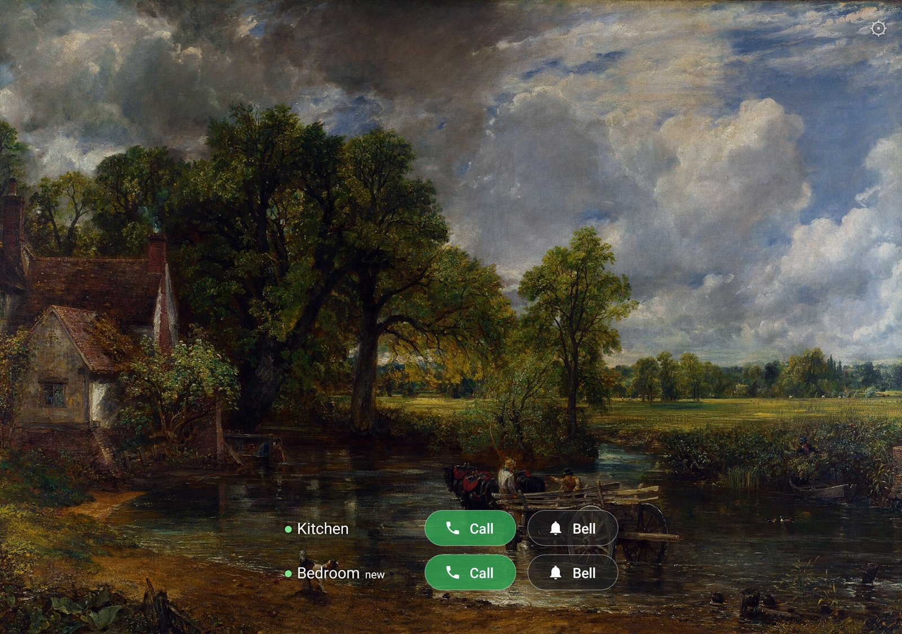
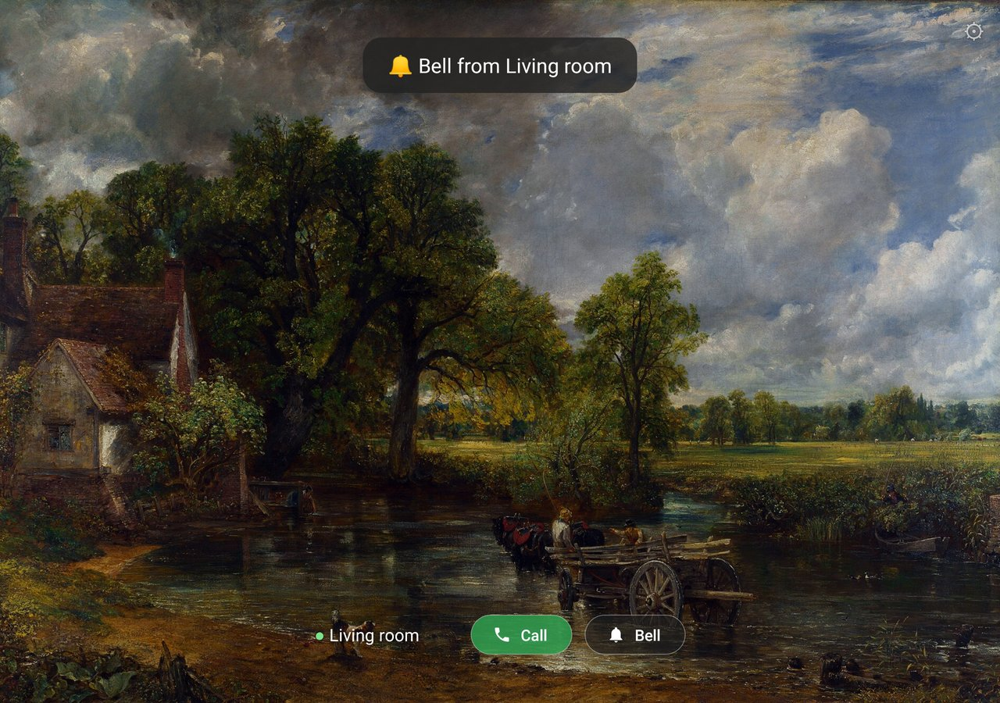
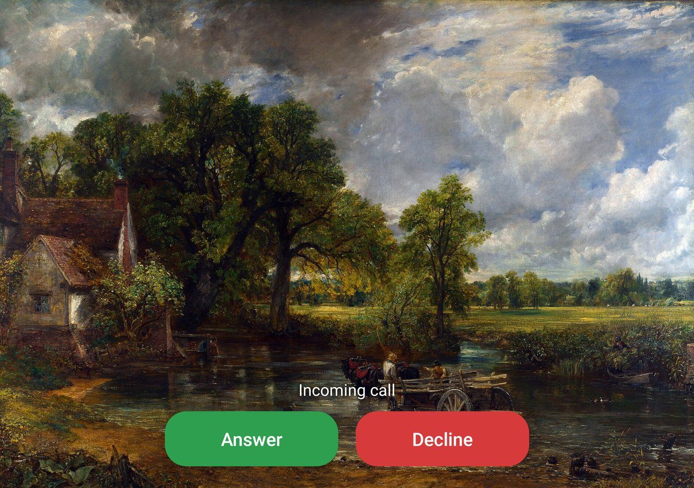
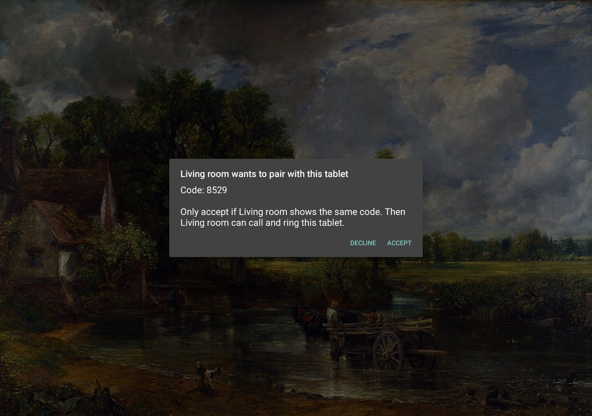
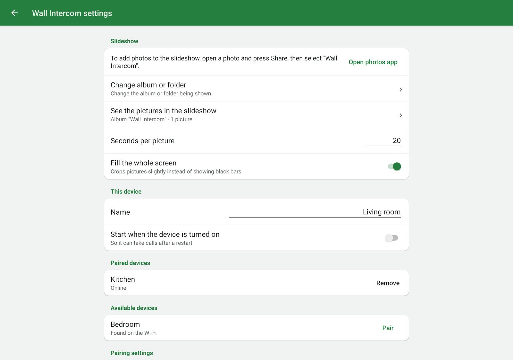

# Wall Intercom

Turn old (or new) Android tablets into wall-mounted **photo frames that double as a video intercom**
between rooms. <br>
There's no server, no cloud and no account: the tablets find each other on your
home Wi-Fi and talk directly to each other.



| Someone rang the bell | Incoming call |
|---|---|
|  |  |

| Pairing two tablets | Settings |
|---|---|
|  |  |

*Screenshots from the Android emulator. The picture is
[The Hay Wain](https://commons.wikimedia.org/wiki/File:John_Constable_-_The_Hay_Wain_(1821).jpg)
by John Constable (1821), which is in the public domain.*

**Built with AI:** all of the code and this README were written by AI. The author wrote no code,
but directed the work and tested the app on the tablets listed under [Features](#features). It
hasn't had an independent security review, so bug reports and code reviews are very welcome.

**Contents:** [Features](#features) · [Requirements](#requirements) ·
[Set up each tablet](#set-up-each-tablet) · [Updating](#updating) ·
[Keeping the tablets plugged in](#keeping-the-tablets-plugged-in) · [Settings](#settings) ·
[Security and privacy](#security-and-privacy) ·
[Kiosk lock-down](#optional-full-kiosk-lock-down-experimental) ·
[Troubleshooting](#troubleshooting) · [How it works](#how-it-works) ·
[Build it yourself](#build-it-yourself)

## Features

- **Slideshow:** a full-screen, cross-fading slideshow from a photo album on the tablet. To add
  photos, select them in Photos or any other app, then choose **Share → Wall Intercom**.
- **Call and Bell buttons:** touch the screen and each tablet appears with an online dot and
  these two buttons. They stay for 25 seconds.
- **Calls that ask first:** **Call** rings the other tablet, which wakes up and shows **Answer**
  and **Decline**. Its camera and microphone stay off until someone presses **Answer**, and a
  short chime then tells the room the camera is on. Unanswered calls stop after 45 seconds and
  show "Missed call from …".
- **A bell with no camera:** **Bell** plays a ding-dong on the other tablet and shows
  "🔔 Bell from …", so the other room can call back when it suits them.
- **One-tap pairing:** other tablets on the Wi-Fi show up by themselves, marked *new*. Press
  Call or Bell on one and both tablets show the same 4-digit code; someone at the other tablet
  then presses **Accept**. Pairings survive IP address and network changes.
- **Automatic answering, if you want it:** off by default. When it's on, the tablet rings the
  bell once and then the call starts by itself.
- **Handles Wi-Fi hiccups:** a call shows **Reconnecting…** and recovers by itself for up to
  30 seconds instead of hanging up.
- **Forgotten calls end themselves:** calls hang up after 15 minutes (configurable), so a camera
  doesn't stay on all night.
- **Made to live on a wall:** it keeps itself running, can dim at night, can start by itself
  after a restart, and can be the home screen on a tablet used only for this.
- **English and Swedish**, following each tablet's language setting.

It's tested on two Lenovo Tab M10 (TB-X505F) with Android 10 and a Lenovo Tab 3 7" (TB3-710F)
with Android 5.0.1. Newer Android versions should work but haven't been tested yet, so please
[open an issue](https://github.com/yymer/wall-intercom/issues) and say how it goes on yours.

## Requirements

- **Two Android tablets** with Android 5.0 or newer, a front camera and an ARM processor (nearly
  all tablets have one). Very old tablets may struggle with HD video, so the default 640×480 is
  the safe choice.
- **The same network** for all tablets, and one that lets devices talk to each other. Guest
  networks often don't (see [Troubleshooting](#troubleshooting)).

Calls only work within your home network. Wall Intercom can't call a tablet somewhere else.

## Set up each tablet

1. **Install the app.** On the tablet, download `wall-intercom-<version>.apk` from the
   [latest release](https://github.com/yymer/wall-intercom/releases/latest) and open it. Android
   may ask you to allow installs from your browser (on Android 7 and older, turn on *Settings →
   Security → Unknown sources*). It may also warn about an app from outside the Play Store or
   one made for an older Android version. Then open Wall Intercom and allow the camera,
   microphone and photos when it asks.

   If you'd rather use a computer with USB debugging on the tablet (`-g` grants the permissions
   up front):
   ```bash
   adb install -r -g wall-intercom-<version>.apk
   ```
2. **Add photos.** Select them in Google Photos, Files or any other app, then choose **Share →
   Wall Intercom**. They're copied into the album *Wall Intercom* (`Pictures/Wall Intercom`),
   which the slideshow shows by default. Sharing the same photo twice doesn't copy it again.
3. **Open the settings.** In Wall Intercom, tap the screen, then **press and hold ⚙** (top
   right). Changes are saved as you make them.
   - *Name*: what the other tablets call this one, e.g. `Kitchen`.
   - *Start when the device is turned on*: turn this on so the tablet can take calls again after
     a restart or power cut.
   - *Allow waking up over other apps* and *Don't let Android put this app to sleep*: press both
     (Android 6 and newer; Android 5 doesn't have them).
   - *Change album or folder* (optional): show another album instead, such as Camera, or any
     folder, such as one on an SD card. *See the pictures in the slideshow* shows what's in it.
4. **Turn off the screen lock.** In Android's settings, set *Security → Screen lock* to **None**
   or *Swipe*, so calls don't get stuck behind the lock screen. With a PIN, pattern or password,
   Android also keeps apps' data locked after a restart until someone unlocks the tablet, so
   Wall Intercom can't start by itself.
5. **Turn off sound "enhancements".** If the tablet has **Dolby Atmos** or similar, turn it off
   under *Settings → Sound*. It confuses echo cancellation and causes echo or noise during calls.
6. **Pair the tablets.** Touch the photo and press **Call** or **Bell** next to a tablet marked
   *new* (or press **Pair** under *Available devices* in the settings). Check that both tablets
   show the same code, then press **Accept** on the other one. With more than two tablets, pair
   each two that should be able to call each other.
7. **Optional, for a tablet that only runs Wall Intercom:** turn on *Use as home screen* under
   *Advanced settings*. Android's list of home apps opens, so choose **Wall Intercom**. The Home
   button and restarts then always come back to the app. If that list doesn't open, press the
   Home button and choose **Wall Intercom → Always**, or look for *Default home app* in Android's
   settings. To undo it, turn the switch off again.

## Updating

Install the new APK over the old one, the same way as above. Your settings and pairings stay.
A tablet may refuse to pair with one running a different version, so update them all together.

## Keeping the tablets plugged in

Wall tablets usually stay on a charger around the clock. Kept at 100% all the time, a lithium
battery wears out faster and can eventually swell, so if the tablet can **stop charging at a
lower level**, turn that on:

- Many tablets have this built in, under names like *Battery protection mode* (Lenovo, stops at
  60%), *Protect battery* (Samsung, 85%), *Battery care* or *charging limit* (Sony, Asus) or
  *Charging optimization* (Google Pixel Tablet, 80%). Look in *Settings → Battery*; names and
  limits vary by brand and Android version.
- Older tablets, like many on Android 5, don't have it. A smart plug or timer that only charges
  a few hours a day does a similar job; keep an eye on the battery level at first.
- Whatever you use, check now and then that the back of the tablet isn't bulging.

### Silencing the "battery protection" notification

When charging stops at the limit, some tablets post a notification with a sound, such as Lenovo's
*Battery Protection mode* (from the system app *LctApplication*). Long-pressing it may say
**"These notifications can't be modified"**, because the manufacturer locked it. It uses the
tablet's default notification sound, though, so you can silence that instead:

- *Settings → Sound → Advanced → Default notification sound* → **None**. The notification still
  shows, silently. Other notifications that use the default sound go silent too, which is usually
  what you want on a wall tablet.
- If it also beeps when charging pauses and resumes: under *Settings → Sound → Advanced*, turn off
  *Charging sounds and vibration*.

This doesn't affect Wall Intercom. The bell and incoming-call ringing play on the *alarm* volume,
and the short chime after *Answer* is a generated tone. Don't set the *notification volume* to 0
or use *Do Not Disturb* instead, because both also mute that chime, which is what tells the room
the camera just turned on.

## Settings

| Setting | Default | Notes |
|---|---|---|
| Seconds per picture | 20 | Photos are shuffled, and the album is re-scanned every round |
| Fill the whole screen | on | Crops pictures slightly instead of showing black bars |
| Start when the device is turned on | off | On Android 10, showing the screen at boot also needs *Allow waking up over other apps*; without it, only the call listener starts |
| Allow pairing requests | on | When off, requests are dropped: nothing shows here, and the other tablet just can't reach this one. Existing pairings keep working |
| Hide unpaired devices | off | Keeps them off the main screen. They're still under *Available devices* in the settings |
| Brightness while showing pictures | 40% | Full brightness when touched or in a call |
| Night mode | off | When on: 22:00–07:00 at 2% brightness. 0% turns the backlight off; a touch, call or bell wakes it |
| Answer calls automatically | off | When on, incoming calls connect without anyone pressing Answer |
| Call volume | 70% | |
| Bell volume | 80% | Plays on Android's *alarm* volume |

Under *Advanced settings*:

| Setting | Default | Notes |
|---|---|---|
| Use as home screen | off | For tablets that only run Wall Intercom |
| Hang up automatically after | 15 min | 0 = never |
| HD video | off | 640×480 when off, which is safest for old tablets |
| Built-in echo cancellation | off | Uses the tablet's own instead of WebRTC's. Try it if you get echo |
| Port | 47555 | Must be the same on all tablets |
| Add device by IP address | | Only needed if a tablet doesn't show up by itself |

## Security and privacy

- **The camera stays off until someone answers.** An incoming call only rings until someone at
  that tablet presses **Answer**. *Answer calls automatically* turns this off for that tablet, so
  only enable it where everyone in that room is fine with it.
- **Only paired tablets can call or ring.** Pairing needs someone at the other tablet to press
  **Accept** after checking that both show the same code. It creates a secret key that only those
  two tablets know (ECDH key exchange). Every connection proves it and every message is signed,
  so nobody else on the network can call, ring or tamper with a call.
- **Compare the code before pressing Accept.** Each tablet commits to its key before seeing the
  other's, so someone intercepting the pairing can't try keys until the codes match. They get one
  guess at a 4-digit code (1 in 10,000) per attempt.
- **Don't accept requests you didn't start.** Anyone on the same network can *ask* to pair, which
  shows a request on the tablet and wakes its screen. The name it shows is chosen by whoever sent
  it. Requests are limited to one per 15 seconds, and only ring the bell once per 5 minutes. To
  undo a pairing, remove the tablet under *Paired devices* in the settings; the other tablet
  forgets this one too.
- **Calls are encrypted and stay on your network.** Audio and video are encrypted by WebRTC
  (DTLS-SRTP) and go directly between the tablets. The app has no ads or analytics and doesn't
  contact any outside server.
- **Some things are visible on your network.** Tablet names are broadcast so that tablets can find
  each other, and the call signalling is signed but not encrypted.
- **Use a network you trust.** Unpaired devices can't do much, because connections have size and
  time limits. Someone on your network can still disturb it, as with any device (a flood of
  traffic can block calls), so don't use a public or guest Wi-Fi.

Found a security problem? Please report it privately through
[GitHub's vulnerability reporting](https://github.com/yymer/wall-intercom/security/advisories/new)
rather than in a public issue.

## Optional: full kiosk lock-down (experimental)

> ⚠️ **This mode is experimental. Don't try it unless you're prepared to factory reset the tablet
> if something goes wrong, which erases everything on it.** Once it's on, Android won't let you
> uninstall the app, even with `adb`. So far it has only been tested on an Android 10 emulator, not
> on real tablets, and calls and bells haven't been tested in this mode. For most people,
> *Use as home screen* is enough.

To make it impossible to leave the app (no status bar, no recent apps), make it *device owner*.
This only works on a tablet with **no Google or other accounts** added, so remove them first or
do it right after a factory reset:

```bash
adb shell dpm set-device-owner se.graw.wallintercom/.AdminReceiver
```

The app then pins itself on screen and, on Android 6 and newer, disables the lock screen.
*Open Android settings* under *Advanced settings* temporarily unpins it.

To undo it, press *Stop being device owner* under *Advanced settings*. You can then leave and
uninstall the app as usual. This button is the only way out short of a factory reset. Anyone who
can open the settings can press it too, so this mode stops casual use rather than someone
determined.

**Install the build you want to keep first:** Android only installs updates signed with the same
key, and you can't uninstall the app while it's device owner. To update, use
`adb install -r wall-intercom-<version>.apk`. The app doesn't reopen by itself after an update and
isn't pinned until it's opened again, so open it afterwards, for example with
`adb shell am start -n se.graw.wallintercom/.MainActivity`.

## Troubleshooting

To see what happened on a tablet, including why a call ended, connect it to a computer and run:

```bash
adb logcat -d | grep CallManager
```

- **A tablet doesn't show up, or shows a grey dot:** check that the app is running on it, and that
  both tablets are on the same network and use the same port. Some routers block the discovery
  broadcasts, so pair with *Advanced settings → Add device by IP address…* instead. Some routers
  also have "client isolation" or "AP isolation" turned on for Wi-Fi, which stops devices talking
  to each other.
- **A paired tablet shows up as *new* again:** that tablet no longer knows this one, because it
  was reset or removed this one while they couldn't reach each other. Press Call or Bell to pair
  again.
- **It says the tablet is "already pairing" right after a declined or cancelled request:** wait
  15 seconds and try again.
- **Echo or noise:** turn off Dolby and other sound enhancements, lower *Call volume*, or try
  *Built-in echo cancellation*.
- **The app stops answering after a while:** press *Don't let Android put this app to sleep* in
  the settings (Android 6 and newer). Some manufacturers also have battery savers in their own
  settings apps.

## How it works

- `IntercomService`: a foreground service holding CPU and Wi-Fi locks so the tablet is always
  reachable. It wakes the screen on an incoming call or bell.
- `Discovery`: UDP broadcasts on port 47555 (`who` / `here`) so tablets find each other and keep
  track of each other's current IP address.
- `Peers` / `Link`: pairing (ECDH, 4-digit comparison code, `pair` with a hash of the key →
  `pairwait` → `reveal` of the key → `pairok`/`pairno`), the stored pair keys, and authenticated
  connections (`auth` → `chal` → `proof`, then every message carries a sequence number and HMAC).
- `LineReader`: reads messages from the network, with a size limit on each.
- `CallManager`: listens on TCP 47555. A call connects to the other tablet and exchanges signed
  one-line JSON messages (`hello` → `ringing` → `ok` / `decline` / `noanswer`, WebRTC
  `offer`/`answer`/`ice`, `bye`). `ping`/`pong` every 20 seconds drives the online dots, and
  `bell` rings the other tablet. Audio and video use WebRTC, peer-to-peer on the LAN (no
  STUN/TURN). On a network hiccup the caller re-opens the socket (`resume`) and does an ICE
  restart; the call only ends if it can't recover within 30 seconds.
- `MainActivity`: slideshow, device rows, call screen and brightness.
- `PairingDialogs`: the pairing dialogs on both tablets.
- `Albums`: lists the tablet's photo albums from Android's media library, and copies shared photos
  into the app's own album.
- `ShareActivity`: the *Share → Wall Intercom* target.
- `SettingsActivity`: the settings form and its pages.
- `PicturesActivity`: the pictures in the slideshow.
- `PhotosApp`: opens the tablet's photos app.

Translations are in `app/src/main/res/values*/strings.xml`. To add a language, copy
`values/strings.xml` to `values-xx/` and translate it.

## Build it yourself

You need JDK 17 or 21 and the Android SDK with platform 35. `build.sh` uses `JAVA_HOME` and
`ANDROID_HOME` if set.

```bash
./build.sh             # -> wall-intercom.apk (ARM, for real tablets)
./build.sh -Pemulator  # also includes x86_64, for testing in the Android emulator
```

These are debug builds, signed with your machine's debug key. Android only installs an update
signed with the same key as the installed app, so to switch between your own builds and the
published ones, uninstall first. That removes the tablet's pairings, so they need pairing again.

### Testing the kiosk mode

This test runs the whole [kiosk mode](#optional-full-kiosk-lock-down-experimental) cycle on a
release build, including getting out with *Stop being device owner*. Run it before each release,
or after changing anything to do with this mode:

```bash
test/device_owner_test.py --avd <emulator name>  # see: emulator -list-avds
```

It builds the APK and starts its own read-only emulator, and refuses to run on anything else. Use
an English emulator image with no accounts. It needs a signing key: a `keystore.properties` next
to `build.sh`, with `storeFile`, `storePassword`, `keyAlias` and `keyPassword`. It leaves
`build/wall-intercom-test.apk` behind, which also contains emulator code, so don't publish that one.

## Contributing

Contributions are welcome, and you don't have to write code: bug reports, translations and hearing
how the app runs on your tablet all help.

**Reporting a bug or suggesting something:** [open an issue](https://github.com/yymer/wall-intercom/issues).
For a bug, include the tablet model, the Android version, what happened and what you expected. The
output of `adb logcat -d | grep CallManager` often helps too. Security problems go through
[private reporting](https://github.com/yymer/wall-intercom/security/advisories/new) instead.

**Changing the code:**

1. For anything bigger than a small fix, open an issue first so we can agree on the approach.
2. Fork the repository and make your change on a branch. [Build it yourself](#build-it-yourself)
   and [How it works](#how-it-works) will get you started.
3. Try it on a real tablet or in the emulator. There are no automated tests, so this is the check
   that matters. Calls and pairing need two devices, ideally two tablets.
4. Open a pull request saying what changed, why, and how you tested it, including the devices and
   Android versions.

A few things to keep in mind:

- **Keep each pull request to one change.** Small ones are easier to review.
- **The app supports Android 5 and up,** so check the API level of any new Android call.
- **Text on screen goes in the string files,** in both `values/` and `values-sv/`. If you don't
  know Swedish, say so in the pull request and it can be translated during review.
- **In the emulator,** tablets can't find each other because broadcasts don't get through. Pair
  from the emulator with *Advanced settings → Add device by IP address…* instead. The tablet can't
  connect back without forwarding port 47555, so test calling from the emulator.

By contributing, you agree that your contribution is licensed under the [MIT license](LICENSE).

## License

[MIT](LICENSE)
